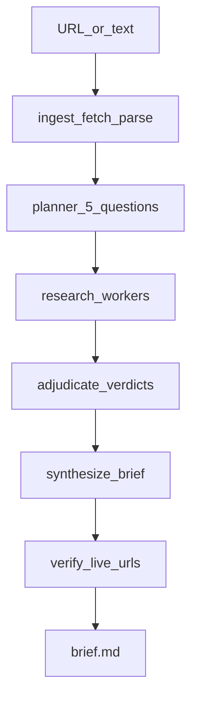

# Briefcase (neatHack job-intel agent)

Product: **Briefcase** — paste a job posting URL or text, get a cited markdown brief covering company, role-fit, interview loop, compensation, and sponsorship/news.

This maps directly onto the published example task (“answer a research question with sources, resolve disagreements, cite”). All code will be written **during** the event (now through Mon Oct 12). Planning is allowed; finished/half-built code is not.

**Deadline:** submit on X as a quote of the official neatlogs post, Mon 12 Oct 2026 · 7:00–11:55 PM IST (final cutoff on Discord). Video ≤3 minutes must cover neatlogs, Entire, and cfo.ai (architecture, implementation, runtime, reasoning, result). Tag public posts `#neatHack`.

## Workspace (do this first after you approve)

No `~/Projects` or `~/Developer` exists. After approval:

1. Create `C:\Users\yaswa\briefcase`, `git init`
2. Call `cursor-app-control.move_agent_to_root` with that path **before** any files
3. Scaffold only after the move

## Constraints vs the original blueprint

- **Models:** do **not** use Bedrock. Hackathon AWS is compute-only. Claim the shared **LiteLLM** key (Nova/Claude, $20/team) at [neatlogs.com/hackathon/models](https://neatlogs.com/hackathon/models) using the team-leader check-in email. Talk to it with the **OpenAI SDK** (`base_url` = LiteLLM), then `neatlogs.wrap(client)` ([Python SDK](https://docs.neatlogs.com/sdk/python)).
- **Search:** you have Crustdata, not Tavily/Serper. Use **DuckDuckGo** (`ddgs`) as the default no-key web search; optional `TAVILY_API_KEY` if you add one later.
- **AWS:** skip for v1 (CLI is enough). Spend the $25 only if we need a public demo host.

## Pipeline (one WORKFLOW trace per brief)

Each box is a `@neatlogs.span` (`CHAIN` / `AGENT` / `TOOL` / `RETRIEVER` as appropriate). `main.py` is a one-shot CLI: `init` → `WORKFLOW` root → `flush()` + `shutdown()`. Persist stage JSON under `runs/<id>/` so a failed stage can resume (judges want a failure-then-recovery trace).

### Core schemas ([models.py](src/models.py))

Keep your `Evidence` / `Verdict` models. Add:

- `JobPosting`: company, title, location, requirements, raw_url, source_text
- `ResearchQuestion`: id, topic (`company|role_fit|interview|comp|sponsorship`), prompt
- `Brief`: markdown, verdicts, evidence, unverified_claims
- Credibility prior table by domain (e.g. levels.fyi / glassdoor / crustdata / official career page > random blogs)

### Stages

| Stage | Implementation | Recovery |
| --- | --- | --- |
| Ingest | `httpx` + `trafilatura` (or readability) for URL; raw text path for paste | retry 3×; if fetch fails, ask for pasted text |
| Parse | LiteLLM structured output → `JobPosting` | retry with truncated text |
| Planner | always emit the 5 questions (template + LLM fill) | fallback to static templates |
| Research | per question: web search + Crustdata `POST /company/enrich` (`basic_info`, `funding`, `people`, `news`, `headcount`, `hiring`) | skip empty search; Crustdata 4xx → continue with web-only and log TOOL error |
| Adjudicate | cluster similar claims; pick winner using **credibility priors** | `--no-priors` for the A/B trace |
| Synthesize | cited markdown; `[n]` maps to `source_url` | never invent URLs — only IDs from `Evidence[]` |
| Verify | HTTP HEAD/GET each cited URL; snippet-in-page check when body is available | drop or flag dead links; optional one rewrite pass |

**Citation honesty (code, not prompt):** only cite `Evidence.source_url` that research actually stored; verify live URLs before writing `brief.md`. Unverified claims go in a “Needs confirmation” section.

## neatlogs (25% judging — make it the improvement story)

- Install `neatlogs` (latest), `python -m neatlogs doctor --local --json`
- `neatlogs.init(api_key=..., workflow_name="job-brief")` once in [tracing.py](src/tracing.py) / [main.py](src/main.py)
- Wrap the OpenAI client; `@span` on every stage and tool (`crustdata_enrich`, `web_search`, `url_check`)
- **A/B evidence (required):** two runs of the same posting — adjudication **with** vs **without** credibility priors. Save dashboard links + compared latency / tokens / cost / unverified-claim count in `hackathon.md`
- **Failure evidence:** force a fetch or Crustdata failure (bad URL / empty key) and show retry/fallback in the same trace

Never commit API keys. `.env.example` lists `NEATLOGS_API_KEY`, `LITELLM_API_KEY`, `LITELLM_BASE_URL`, `CRUSTDATA_API_KEY`, optional `TAVILY_API_KEY`.

## Entire (build-time, not runtime of Briefcase)

You already have Entire. Use it **while building** this repo:

- `entire enable` on `briefcase`
- Checkpoints after the ingest module works, after research+adjudicate works, after first successful brief
- `entire graph search` / `entire graph snapshot` — save sanitized output to `docs/entire-graph.md` for judges
- Record checkpoint IDs in `hackathon.md`

## cfo.ai (business plan — do as soon as you have one real trace cost)

Do **not** wait until Monday morning. Model **one brief** as the unit:

- Costs: LiteLLM tokens (from neatlogs) + Crustdata credits + search
- Tiers: freemium (N briefs/week) + B2B career-center (seats or volume)
- Outputs judges want: pricing, costs, revenue, runway
- Export/write [docs/business-plan.md](docs/business-plan.md)
- Hackathon reminder: card on signup → **cancel immediately** in Settings → Billing; credits come from the neatHack team

## File layout (product name Briefcase, repo `briefcase/`)

Same as your blueprint, plus:

- `hackathon.md` — neatHack build log (project, team, stack, dated evidence, demo, submission checklist)
- `.agents/skills/neathack/SKILL.md` — from [neatlogs.com/hackathon/skill](https://neatlogs.com/hackathon/skill)
- `runs/` gitignored except a sanitized sample

Stack: Python 3.11+, `pydantic`, `openai`, `neatlogs`, `httpx`, `trafilatura`, `ddgs`, `python-dotenv`, pytest.

## Timebox (remaining ~40h to planned close)

1. **Setup (first session):** repo, env, LiteLLM claim, hello-world wrapped LLM call → one neatlogs trace
2. **Vertical slice:** ingest → parse → one research question → stub verdict → brief.md
3. **Full five questions + Crustdata + verify**
4. **A/B traces + failure/recovery run**
5. **Entire graph dump + cfo.ai plan**
6. **Demo video + `#neatHack` public posts + X quote submit**

CLI first. No web UI unless the slice is done with hours to spare.

## Tests (thin, hackathon-speed)

- Parser: fixture HTML → `JobPosting` fields
- Adjudicate: two conflicting `Evidence` rows → expected winner with priors vs without
- Verify: mock HTTP 404 → claim flagged
- Golden: one fixture posting text (no live net) produces a brief with citation IDs that exist in evidence

## What you still need to do manually

- Claim LiteLLM key; confirm `CRUSTDATA_API_KEY` and `NEATLOGS_API_KEY` in `.env`
- Sign up / cancel cfo.ai billing if not already
- Public repo + dated commits; 3-min demo; quote-tweet submit when the window opens
- Building in public (15%): short posts with `#neatHack` after the first trace and after the first real brief
